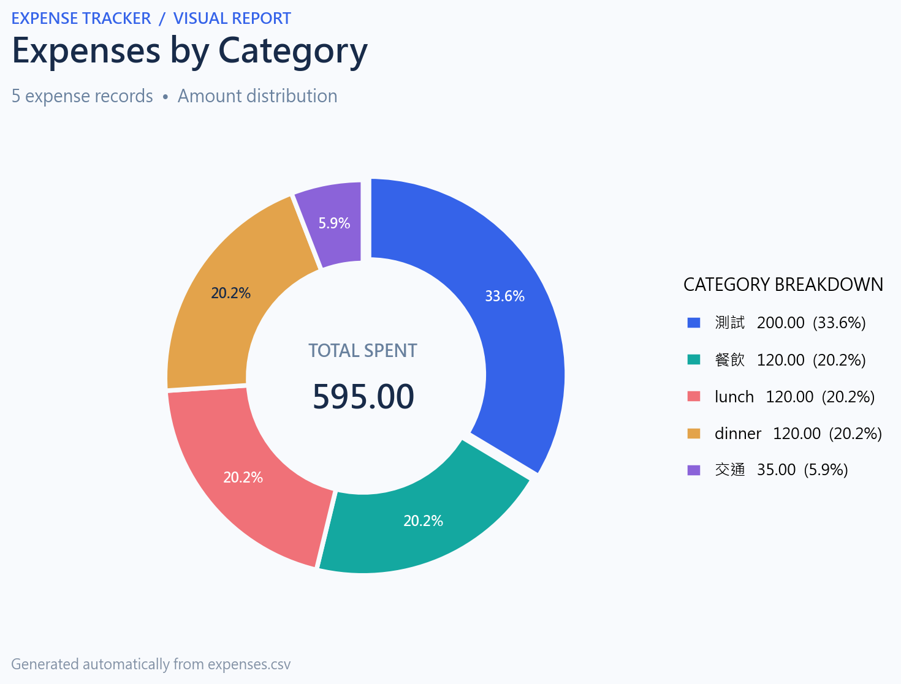

# Expense Tracker 💳

**Introduction to Software Engineering — Assignment 1: Version Control Practice**

A two-person Python project that records expenses in CSV format and visualizes spending with a category-based pie chart. Developed collaboratively using Git feature branches and merge commits.

## ✨ Features

| Member A — Input Module | Member B — Visualization Module |
|---|---|
| Add multiple expense entries | Read saved CSV expense records |
| Validate dates, positive amounts, and categories | Group and total expenses by category |
| Optional notes and persistent CSV storage | Generate a styled pie/donut chart with percentages |
| Colorful terminal menu, recent history, and summary | Save a PNG report automatically |

## 📁 Project Structure

```text
expense-tracker/
├── input.py                   # Input module and terminal menu (Member A)
├── visualization.py           # Visualization module (Member B)
├── requirements.txt           # Python dependency list
├── images/
│   └── sample_pie_chart.png   # Generated sample chart
├── README.md
├── .gitignore
└── expenses.csv               # Created locally; not committed to Git
```

**Data columns:** `date,amount,category,notes` (UTF-8 CSV)

## ⚙️ Setup

Requirements: **Python 3.10 or later** and a terminal (VS Code terminal recommended).

```powershell
git clone https://github.com/1y0u1y0u/expense-tracker.git
cd expense-tracker
git switch test-merge
python -m pip install -r requirements.txt
```

> The integration work is maintained on `test-merge`. After the final version is merged into the default `main` branch, `git switch test-merge` is optional.

## ▶️ How to Run

### Step 1: Record expenses

```powershell
python input.py
```

Choose an option in the terminal:

- `1` — Add expense (date, positive amount, category, optional notes)
- `2` — View up to eight recent entries
- `3` — View total spending by category
- `0` — Exit

After each entry, type `y` to add another or `n` to return to the menu. Press Enter at the date prompt to use today's date.

Expenses are saved to **`expenses.csv`** in the same folder as `input.py`. The file is not overwritten when additional expenses are entered.

### Step 2: Display the pie chart

```powershell
python visualization.py
```

The script reads **`expenses.csv`**, totals positive amounts by category, displays the pie chart, and saves a screenshot-ready PNG to **`images/sample_pie_chart.png`**.

### Example data

| date | amount | category | notes |
|---|---:|---|---|
| 2026-11-22 | 200 | Food | Lunch |
| 2026-11-22 | 100 | Transport | Bus |
| 2026-11-22 | 300 | Food | Dinner |
| 2026-11-22 | 400 | Entertainment | Movie |

Expected totals: **Food 500 (50%)**, **Transport 100 (10%)**, **Entertainment 400 (40%)**.

## 📊 Sample Pie Chart



The sample chart is generated by `visualization.py` using the example expenses above. Running the visualization again overwrites the PNG with a chart based on your current local CSV.

## 🛠️ Troubleshooting

- **`No expenses.csv found`** — Run `python input.py` and add at least one expense.
- **`No module named matplotlib`** — Run `python -m pip install -r requirements.txt`.
- **Chinese labels appear as boxes** — Use English categories, or install a Chinese-capable font such as Microsoft JhengHei or Noto Sans CJK and rerun.
- **Wrong visualization filename** — Use `visualization.py` (not `visualize.py`).

## 🌿 Git Collaboration

- **Member A:** `feature-input` — expense input and CSV storage
- **Member B:** `feature-piechart` — category-based visualization
- **Integration:** `test-merge` — brings both modules together
- **Polish:** `feature-ui-polish` — interface, chart, and documentation improvements

The project retains separate branches, contributor history, and merge commits so the GitHub **Insights → Network** graph shows collaboration.

## 🎥 Demonstration

The demo video shows how to add several expenses, check the CSV data, display the generated chart, and inspect the Git branch/merge history.

